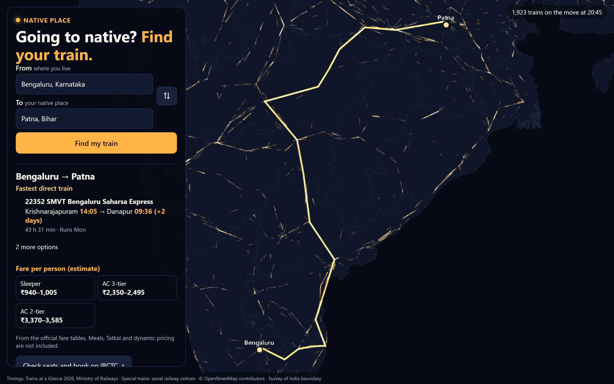
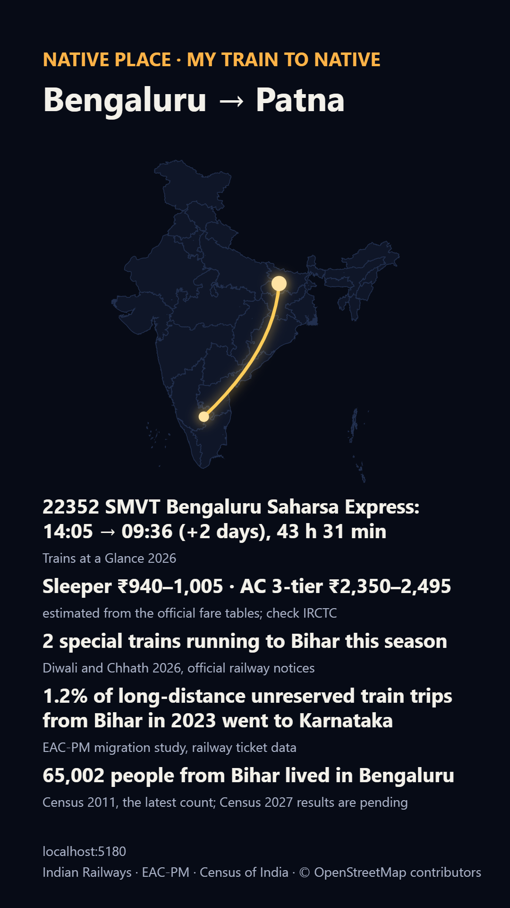

# Ghar Wapsi

**India's festival homecoming, animated.** Every long-distance train on one night, the 2026
Diwali and Chhath specials heading home, and a card that shows your own journey.

**Live:** [aftabbs.github.io/ghar-wapsi](https://aftabbs.github.io/ghar-wapsi/)

<p>
  
  
</p>

## What it shows

- **The night map.** 2,626 trains from the official 2026 timetable, crossing
  India over one day compressed into 60 seconds.
- **Festival mode.** 113 Diwali and Chhath special trains, each taken from an official railway
  notice and linked to it. The ones heading home glow gold.
- **From Bengaluru.** The specials leaving India's largest southern work hub for Bihar,
  Bengal, Jharkhand and Assam.
- **Explore.** Switch to satellite imagery with state, district and station names, then tap
  a train for its timings, stops, days, classes and an estimated fare range, or tap a
  station, district or state for its trains, specials and where people travel.
- **My journey home.** Pick your city and home district to get a phone-sized card: a short
  story line in English and Hindi, then the fastest direct train, the specials on your route,
  where people from your state travel, and how many live in your city.

## Data

| What | Source | Date |
|---|---|---|
| Train timings | [Trains at a Glance](https://indianrailways.gov.in/railwayboard/view_section.jsp?lang=0&id=0,1,304,366,537,3143), Ministry of Railways (Railway Board) | Effective 1 Jan 2026 |
| Festival specials | Zonal railway press releases on `*.indianrailways.gov.in` | Checked 17 Oct 2026 |
| Rail travel between states | [EAC-PM, *400 Million Dreams*](https://eacpm.gov.in/wp-content/uploads/2024/12/FINAL-Internal-Migration-Project.docx-Publication-Version.pdf), Table 7 | 2023 |
| People living in another state | Census of India, Table D-02 | 2011, the latest count |
| Fares (estimates) | Trains at a Glance 2026 fare tables + Commercial Circular 24/2025 | w.e.f. 1 Jul 2025, revised 26 Dec 2025 |
| Satellite imagery | [Sentinel-2 cloudless 2024](https://cloudless.eox.at) by EOX, CC BY-NC-SA 4.0 | 2024 |
| Station locations | [DataMeet](https://github.com/datameet/railways) + [OpenStreetMap](https://www.openstreetmap.org/copyright) | OSM Oct 2026 |
| Boundaries | Survey of India outline via [DataMeet maps](https://github.com/datameet/maps) | — |

Census 2027 migration tables are not yet published; the card shows the 2011 count with its
date beside the 2023 rail-travel figure. The [methods page](https://aftabbs.github.io/ghar-wapsi/methods.html)
explains every check and limit.

### How the timetable is checked

Trains at a Glance is published as 97 PDF tables. The pipeline reads every table, joins each
train across tables, matches station names to codes, and drops any train whose times run
backwards or whose speed is impossible. Of 3,576 trains in the timetable, 2,626 pass. For the
596 that start and end at the same stations in an independent 2016 timetable, the median
journey-time ratio is 0.99 and 97.8% are within 25%. Every count is in
[`pipeline/report.json`](pipeline/report.json).

## Run it locally

Requires Python 3.10+ and Node 22+.

```bash
# data pipeline (downloads about 250 MB of sources into data/raw)
python -m pip install -e ".[dev]"
cd pipeline
python -m ghar.fetch          # DataMeet, OpenStreetMap, Census 2011 tables
python -m ghar.tag_extract    # Trains at a Glance 2026 PDFs -> table cells (about 6 minutes)
python -m ghar.build          # writes web/public/data and pipeline/report.json
python -m ghar.narrate        # optional: story lines via Groq (GROQ_API_KEY in .env)
python -m ghar.narrate --from-cache   # rebuild story lines from data/narrations, no key
```

```bash
# web app
cd web
npm ci
npm run dev                   # http://localhost:5173
```

The built data is committed, so the web app runs without the pipeline.

## Project layout

| Path | What it does |
|---|---|
| `pipeline/ghar/tag_extract.py` | Downloads Trains at a Glance 2026 and extracts every table |
| `pipeline/ghar/tag.py` | Reads train columns, joins tables, matches stations, validates |
| `pipeline/ghar/stations.py` | Merges DataMeet and OpenStreetMap stations, assigns districts |
| `pipeline/ghar/specials.py` | Validates the hand-transcribed festival specials |
| `pipeline/ghar/census.py`, `eacpm.py` | Census 2011 D-02 and EAC-PM 2023 tables |
| `pipeline/ghar/routes.py` | Fastest direct train from 20 cities to every district |
| `pipeline/ghar/pack.py` | Packs trips into a compact binary for the browser |
| `data/specials/` | The festival specials, one official source link per train |
| `web/` | The map (deck.gl), the card and the methods page |
| `tests/`, `web/src/*.test.ts`, `web/e2e/` | Pipeline, unit, browser and accessibility tests |

## Tests

```bash
python -m pytest                      # pipeline (real-data tests run when data/raw exists)
cd web && npx vitest run              # card, festival and decoder logic
cd web && npm run build && npx playwright test   # browser flow and WCAG 2.2 AA checks
```

## Found a mistake?

[Open an issue](https://github.com/Aftabbs/ghar-wapsi/issues) with the train number or district
and the source that shows the right value. Always confirm a journey on NTES or IRCTC before you
travel.

## Licences

Code: [MIT](LICENSE). Data: see [web/public/data/LICENSES.md](web/public/data/LICENSES.md).
